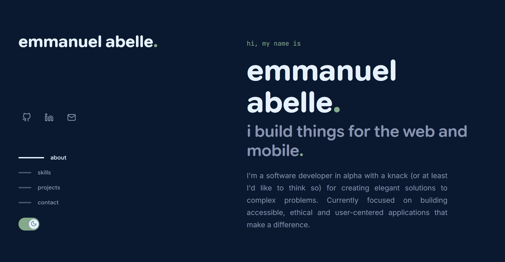

<div align="center">

# Emmanuel Abelle — Portfolio

A modern, responsive personal portfolio built with **SvelteKit** and **TypeScript**.

**[emmanuel.abelle.site](https://emmanuel.abelle.site)**



</div>

---

## Features

- **Interactive Animations** — Smooth reveal transitions, 3D hover effects, and scramble text built with custom Svelte actions
- **Fully Responsive** — Adapts seamlessly from mobile to desktop with a collapsible sidebar layout
- **Dark Mode**
- **Project Showcase** — Cards with live images, GitHub links, and Play Store badges
- **SEO Optimised** — JSON-LD structured data, Open Graph tags, sitemap, and prerendered static pages
- **Fast** — Static site generation via SvelteKit for instant load times

## Tech Stack

| Layer | Technology |
|-------|-----------|
| Framework | [SvelteKit](https://kit.svelte.dev/) |
| Language | [TypeScript](https://www.typescriptlang.org/) |
| Bundler | [Vite](https://vitejs.dev/) |
| Styling | CSS custom properties + responsive design tokens |
| Deployment | Static adapter (prerendered) |

## Getting Started

### Prerequisites

- [Node.js](https://nodejs.org/) (LTS recommended)
- npm, pnpm, or yarn

### Setup

```bash
# Clone the repository
git clone https://github.com/Wazzicus/Portfolio.git
cd Portfolio

# Install dependencies
npm install

# Start the dev server
npm run dev
```

The app will be available at `http://localhost:5173`.

### Production Build

```bash
# Build for production
npm run build

# Preview the build locally
npm run preview
```

## 📄 Licence

All rights reserved.
